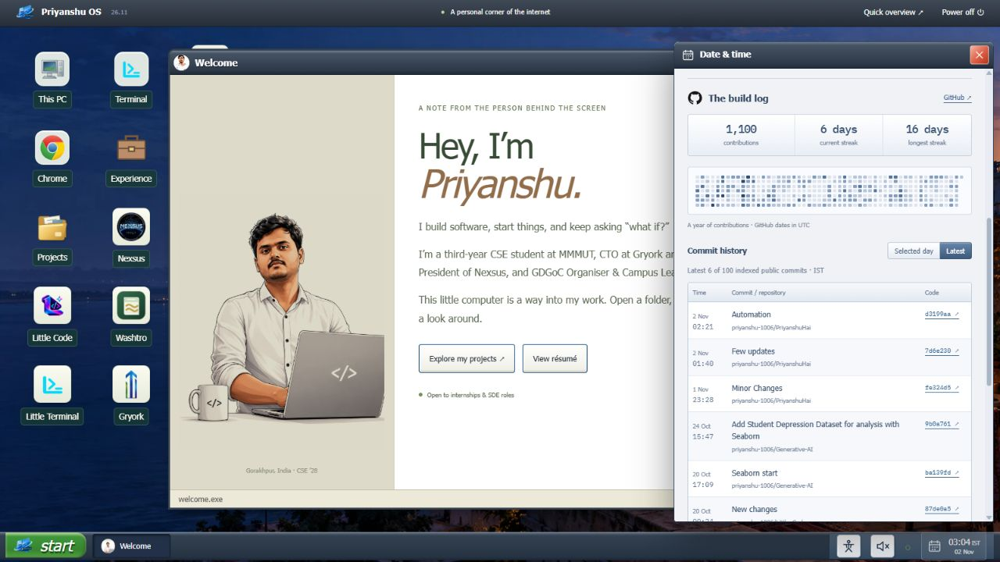

# Portfolio - Priyanshu Chaurasia

[Visit the live portfolio](https://priyanshu-hai.vercel.app/)

React + Vite + Tailwind v4 + React Router. Deploys to Vercel as-is.

## Run it

```bash
npm install
npm run dev      # http://localhost:5173
npm run build    # production bundle into dist/
npm run lint
npm test
npm run check:release
```

## Where the content lives

Core profile and project content is data-driven. The desktop applications and page layouts live in components.

| File | What it holds |
|---|---|
| `src/data/profile.js` | Name, bio, contact, skills, education, experience and achievements |
| `src/data/projects.js` | Every project and its full case study |
| `src/data/recentProjects.js` | Five recent products, their evidence boundaries and screenshot galleries |
| `src/data/projectOrder.js` | Shared project priority for the showcase, desktop, and next-project links |
| `src/data/calendarEvents.js` | Annual birthdays and dated milestones in the taskbar calendar |
| `src/data/github.json` | Saved contribution calendar, repository details and recent public commit history |
| `scripts/refresh-github-local.mjs` | Validated daily data publisher using a separate local checkout |
| `docs/project-readmes/` | Source READMEs the case studies were written from |

### Adding a project

Copy any existing object in `src/data/projects.js` and edit it. Only `slug`, `title`,
`blurb`, `tech`, `year`, `role`, `category` and `status` are required - every other
field is optional and its section simply will not render if you leave it out.

- `slug` becomes the URL: `/projects/your-slug`
- `featured: true` puts it under "Principal work" instead of "Also built"
- `architecture` is a plain string - paste an ASCII diagram straight in, it is
  rendered in monospace and scrolls horizontally on small screens

### Media fields

| Field | Shape | Notes |
|---|---|---|
| `cover` | `"/image.png"` | Full-width hero on the case-study page |
| `gallery` | `[{ src, caption }]` | Grid with a keyboard-navigable lightbox, lazy-loaded |
| `videos` | `[{ id, label }]` | YouTube **video ID only**, not the full URL |
| `embed` | `{ url, height }` | Click-to-load iframe of the deployed app |

For `videos`, take just the ID: `https://youtu.be/kM7VeWXM6iA` becomes
`{ id: "kM7VeWXM6iA", label: "Walkthrough" }`. Videos load a cheap poster frame
first and only pull the YouTube iframe if someone clicks play.

Images go in `public/` and are referenced from the site root - `public/foo.png`
is `"/foo.png"`. **Avoid spaces in filenames.**

### Adding your resume

Drop `resume.pdf` into `public/` and it is served at `/resume.pdf`.

### Screenshots

Put images in `public/projects/<slug>/` and reference them as
`/projects/<slug>/name.png`.

## Design system

The overview, project showcase, individual case studies and writing support both
neutral light and true black dark palettes. The navigation toggle persists the
choice; the device preference is used until a choice is saved. The homepage room has its own three
appearance choices; the XP desktop retains its graphite chrome and classic controls.

**Tokens** live at the top of `src/index.css`:

- `:root` / `[data-theme="light"]` and `[data-theme="dark"]` define `--c-*` colours
- `@theme` maps them to Tailwind utilities (`bg-bg2`, `text-ink2`, `border-rule`, `text-accent`)
- A fluid type scale (`--fs-*`), tracking (`--tr-*`) and leading (`--lh-*`) drive
  the `.t-display` / `.t-h1` / `.t-h2` / `.t-h3` / `.t-lead` / `.t-label` roles

**Typography**: Instrument Sans for display and reading, Instrument Serif for expressive accents,
and IBM Plex Mono for labels and terminal content. Fonts are hosted locally, with licenses in
`public/fonts`. Headings use restrained weights and accessible entrance animations.

Shared text and control tokens keep both reading themes consistent.

### Per-project themes

`src/data/projectThemes.js` supplies the shared neutral light/dark palettes and retains
project typography metadata. `<ProjectTheme slug={slug} />` applies the selected palette
on project pages and restores the shell on unmount. Brand logos and product
screenshots retain their original colours. Dark uses black surfaces; light uses neutral whites without a green tint.

## Components

| Component | Purpose |
|---|---|
| `components/Device.jsx` | `MacBook`, `Phone`, `DevicePair` frames. Hold a screenshot, or a live site rendered at desktop width and CSS-scaled to fit |
| `components/Carousel.jsx` | Auto-advancing slide track. Every slide stays mounted, so a loaded iframe survives sliding away. Pauses on hover, focus and hidden tabs; disabled under reduced motion |
| `components/Media.jsx` | `Gallery` (lightbox, keyboard-navigable) and `VideoEmbed` (poster first, iframe only on click) |
| `components/ProjectTheme.jsx` | Applies the selected light/dark reading palette |

## Bespoke project pages

Each project has its own page and product-specific layout within the shared palette.

1. Create `src/pages/projects/YourProject.jsx` — a self-contained component
2. Register it in `src/pages/projects/index.jsx`

```jsx
const PAGES = {
  'nexsus-universe': <NexsusUniverse />,
  'your-slug': <YourProject />,
}
```

Anything not registered falls back to the generic case-study template in
`ProjectDetail.jsx`, so the site is never broken mid-migration.

**All 25 projects have one.** The larger case studies define their own layout primitives; lighter ones share `src/components/project/Scaffold.jsx`. The five recent additions use `src/components/project/CaseStudy.jsx` with individual product sections. Case studies load on demand.

The homepage uses the supplied 3D computer as the entrance to Priyanshu OS. Scroll into the
monitor or use Enter computer, then explore desktop applications and project windows.
`/projects` is the dedicated screenshot showcase and searchable archive; `/overview` is the
direct reading route. See `docs/computer-experience.md` for controls, assets and validation.

The first homepage visit includes a replayable startup with optional original sounds. Right-click
the scene or desktop for display, accessibility and shortcut controls. The floating portfolio
guide is a local expert system with 22 saved answers and connected questions. Its editable input/output
library is `src/data/assistantKnowledge.js`; the contract is in `docs/expert-guide-contract.md`.

Click the taskbar date/time to open the live IST calendar. Birthdays recur yearly;
the IIT Bombay Techfest win stays on 21 December 2025. Under the calendar, the
GitHub build log shows the contribution graph and a table of public commits.
Select a date or choose Latest; rows include IST times, messages, repositories
and real commit links. Add personal dates in `src/data/calendarEvents.js`,
omitting `year` only for recurring events.

The table covers up to 100 recently indexed public commits. The yearly graph
can also include anonymised private activity shared on the GitHub profile.



## Daily GitHub updates without GitHub Actions

A local Codex automation runs at **11:17 AM IST**. Keep the computer online,
Codex running and this project available. It uses your existing Git login.

```bash
npm run refresh:local     # Check the complete job without committing or pushing
npm run refresh:publish   # Publish one data-only update when due
```

The runner works in `.automation/github-refresh`, a separate ignored clone. It
checks the daily guard, refreshes GitHub data and recent public commit history,
runs tests and a production build, then commits only `src/data/github.json`.
It never stages or commits unfinished work in your normal portfolio checkout.
The status is recorded in `.automation/last-run.json`.

The app's Scheduled view manages **Refresh portfolio GitHub activity**.
The Actions workflows were removed; push these source changes once to remove
those workflows remotely and publish the calendar update. Vercel's Git
integration should keep deploying `main`. No personal token is required for the
public calendar; the job cannot run while the computer/app is unavailable.

See `docs/github-activity-setup.md` for the complete setup, retry behaviour,
optional deployment hook, time zones and commit attribution. Project media and
release notes are in `docs/github-ready.md`.

## Images

- Device frames `contain` rather than crop, because the screenshots are ~2.2:1
  browser captures and the MacBook screen is 16:10. The letterbox is black so it
  reads as bezel. Pass `fit="cover"` or `aspect="..."` to override.
- A project with `shot: null` renders a "screenshot pending" panel instead of
  framing an unsuitable image.
- Tech icons live in `public/svg/` and are mapped in `src/data/techStack.js`.
  An entry with `icon: null` falls back to a monogram tile.

## Deploy

Push to GitHub, import the repo on Vercel, accept the detected Vite settings.
`vercel.json` already rewrites all routes to `index.html` so deep links to
`/projects/<slug>` work on refresh.
